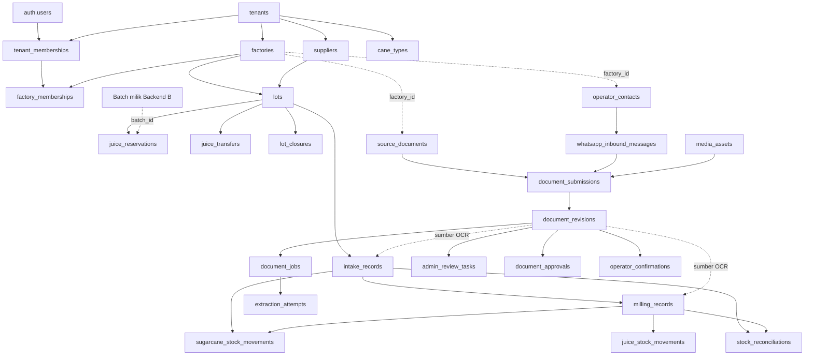

# Review backend, seed, dan rancangan database SobatNira

Tanggal: 19 November 2026. Status: bahan diskusi sebelum implementasi dan migration berikutnya.

Review ini membaca source workspace, termasuk perubahan yang belum di-commit. Tidak menjalankan migration, provisioning, seed database, atau perubahan layanan eksternal. Jumlah tabel di bawah adalah definisi dalam migration repo, bukan hasil introspeksi database tim saat ini. Tidak ada aturan produksi baru yang ditetapkan.

Indeks `docs/internal/index.md` tidak tersedia pada workspace saat review. Keputusan domain yang masih terbuka perlu dikonfirmasi kepada tim. Catatan smoke terdahulu pada [log AI](ai/IMPLEMENTATION_LOG.md) tetap diakui sebagai bukti historis, bukan hasil pengujian ulang layanan live hari ini. [Audit awal](ai/IMPLEMENTATION_AUDIT.md) adalah baseline lama; pernyataan di sana bahwa database/OCR/auth belum ada sudah tidak menggambarkan kode terbaru.

## 1. Kesimpulan

Backend A sudah memiliki fondasi transaksi penerimaan tebu, penggilingan, stok, reservasi/transfer nira, review nota dan audit. Backend produksi hilir belum lengkap di repo ini: belum ada model batch resmi, pencatatan hasil/grade ternormalisasi, harga historis, biaya persisten, serta laporan yang membaca transaksi sah. Kalkulasi yang baru ditambahkan masih preview tanpa persistensi.

Data demo Flutter, fixture API, gambar OCR sintetis dan fixture perhitungan adalah empat sumber berbeda. Menambah variasi pada satu generator tidak otomatis mengubah layar yang masih membaca konstanta Flutter.

## 2. Status implementasi

`Ada` berarti kode tersedia dan memiliki tes terkait; tidak berarti seluruh alur telah terverifikasi pada deployment produksi. `Parsial` berarti komponen sudah ada tetapi ada bagian atau integrasi yang belum selesai. `Belum ada` dibatasi pada repo yang ditinjau; Backend B dapat berada di repo tim lain.

| Area | Status | Yang tersedia | Yang masih perlu diselesaikan / dibuktikan |
| --- | --- | --- | --- |
| Auth dan scope tenant/pabrik | Ada | Supabase token, membership aktif, role admin/owner, global guard | Uji pencabutan akses konsisten pada jalur OCR yang memakai membership terpisah |
| Master pemasok | Ada | Buat, baca, edit, nonaktifkan, pencarian, pagination, audit | Kebutuhan metadata pemasok tambahan harus disepakati |
| Master jenis tebu | Ada | Katalog tenant, kode stabil, status aktif, audit | Hubungan katalog ke kode/label mentah nota belum berupa FK katalog |
| Identitas kloter | Ada | Pemasok, pabrik, tanggal, kode tampilan, riwayat | Kode tampilan belum menjadi nomor resmi unik; aturan penomoran perlu keputusan |
| Penerimaan tebu sah | Ada | Approval OCR mengikat revisi, membuat receipt dan kredit stok secara transaksional | Pengujian ulang DB dan smoke akun nyata pada audit ini tidak dilakukan |
| Penggilingan sah | Ada, dengan batasan | Satu penggilingan penuh per kloter; nota multiblok dapat membukukan beberapa kloter | Jika operasional perlu penggilingan parsial/berulang, model saat ini harus ditinjau dahulu |
| Stok tebu dan nira | Ada | Ledger, pemisahan sintetis/riil, konversi L ke ml, validasi saldo | Semua klien hilir harus memakai kontrak saldo/reservasi yang sama |
| Reservasi/consume/release nira | Ada | Idempotency, state, lock kloter, asal nira | `batch_id` merupakan UUID eksternal; validitas batch menjadi tanggung jawab B |
| Transfer nira | Ada | Satu pabrik, transaksi dua kloter, asal nira dipertahankan | Kebijakan lintas pabrik belum disepakati dan bukan fitur yang tersedia |
| Tutup/buka kembali kloter | Parsial | Saldo/reservasi, audit alasan, riwayat, kontrak HTTP B | Implementasi nyata `/batches/closure-check/:lotId` dan smoke lintas layanan diperlukan |
| Koreksi stok setelah pengesahan | Parsial | Revisi dan delta koreksi teraudit | Ditolak setelah stok dipakai/direservasi/ditransfer atau kloter tertutup; koreksi berantai belum tersedia |
| Intake WhatsApp dan job OCR | Ada | Token internal, operator, idempotency, duplikasi, lease dan retry PostgreSQL | Kapasitas dan recovery perlu diuji untuk beban deployment; jangan menganggap Redis/BullMQ sudah dipakai |
| OCR dua tipe nota | Ada, kualitas belum final | PaddleOCR, parser, evidence, crop Gemini, klarifikasi/manual entry | Benchmark nota lapangan anonim dan target akurasi per field belum disepakati |
| Konfirmasi dan review nota | Ada | Revisi spesifik, konfirmasi operator, koreksi, return, approval, notifikasi | Konsistensi otorisasi dengan membership bisnis dan kebijakan role perlu dirapikan |
| Media bukti | Ada, operasional parsial | Penyimpanan privat, validasi gambar, akses melalui API | Retensi, orphan saat gangguan panjang, backup/restore dan rekonsiliasi objek belum lengkap |
| Kontak operator | Ada | CRUD terbatas, aktif/nonaktif, audit, nomor unik | Satu nomor saat ini satu pabrik; multi-pabrik memerlukan perubahan model jika dibutuhkan |
| Batch masak resmi | Belum ada di repo ini | Referensi JSONB dari nota dan UUID batch pada reservasi | Entitas batch, state, sesi/wajan, pemakaian nira, hasil, grading dan validasi persisten |
| Wajan, shift dan aturan kapasitas | Belum ada sebagai master backend | Demo Flutter dan nomor wajan pada payload | Master dan riwayat efektif; batas kapasitas operasional harus ditetapkan tim |
| Grade, harga dan biaya | Belum ada sebagai model persisten | Demo grade/harga dan input eksplisit pada calculator | Katalog, harga berlaku, pencatatan biaya, snapshot historis dan dasar alokasi |
| Kalkulasi rendemen/margin | Parsial | BigInt, validasi input, preview/rekap, tes pembulatan | Penetapan formula resmi, basis kuantitas, pembulatan, snapshot dan integrasi transaksi sah |
| Laporan produksi/margin | Belum terhubung transaksi backend | Halaman/PDF demo; endpoint `calculation-preview` dan `recap-preview` | Endpoint read-only dari data sah, scope, periode, total, detail dan ekspor snapshot yang sama |
| Pengaturan pabrik dan akun | Parsial | Baca pabrik/membership; operator dan katalog tertentu sudah API | Profil lengkap, undangan, mutasi role, shift, fasilitas, BTP, harga/biaya dan alias OCR masih belum lengkap |
| Seed database terpadu | Belum ada | Fixture perhitungan, bootstrap lokal, fixture rollback | Generator dataset persisten khusus development yang idempotent dan konsisten lintas modul |
| CI dan deployment | Parsial | Workflow build/test tiga layanan dan pemeriksaan kesiapan terpisah | CI saat ini manual; suite integrasi bisnis tidak seluruhnya dipanggil job CI; runbook deploy/restore perlu dilengkapi |

Sumber utama: [Auth](../apps/api/src/auth/), [produksi](../apps/api/src/production/), [penerimaan](../apps/api/src/documents/truck-intake.ts), [penggilingan OCR](../apps/api/src/documents/production-milling.ts), [nira](../apps/api/src/juice/), [review](../apps/api/src/documents/review.ts), [OCR](../apps/ai/ocr_service.py), [pengaturan demo](../apps/mobile/lib/features/pengaturan/settings_demo.dart), [CI](../.github/workflows/ci.yml).

## 3. Daftar penyelesaian berdasarkan prioritas

Urutan ini adalah usulan pengerjaan, bukan persetujuan mengubah skema.

| ID | Prioritas | Temuan | Penyelesaian dan bukti selesai |
| --- | --- | --- | --- |
| B01 | Sebelum desain migration | Batas kepemilikan Backend A/B belum cukup untuk menetapkan tabel batch | Sepakati siapa memiliki batch, hasil, grading, harga, biaya dan API closure-check; satu pemilik untuk setiap transaksi |
| B02 | Sebelum desain migration | Keputusan formula, satuan dan alokasi campuran belum final | Catat keputusan rendemen, waktu pengukuran Brix, satuan gamping, dasar harga dan alokasi hasil/biaya; sertakan contoh hitung disetujui |
| B03 | Tinggi | Dua sumber membership: `factory_memberships` dan `review_memberships` | Pencabutan/penonaktifan akses bisnis harus konsisten menolak list/detail/media/koreksi OCR, bukan hanya validasi yang memanggil akses produksi; tambahkan tes revocation |
| B04 | Tinggi | Belum ada lifecycle batch resmi | Modelkan draft, tinjau, sah, koreksi/pembatalan sesuai keputusan tim; tes restart, stale revision dan pemakaian nira sekali |
| B05 | Tinggi | Laporan dan rincian demo tidak bersumber dari transaksi yang sama | Bangun query laporan dari hasil sah dan snapshot biaya; total kartu, grafik, tabel, detail serta PDF harus cocok |
| B06 | Tinggi | Closure bergantung layanan B yang tidak ada implementasinya di repo | Uji B dengan identitas/scope nyata, `canClose=false`, timeout, batch belum sah, dan persaingan dengan reservasi baru |
| B07 | Tinggi | Harga/biaya belum historis | Harga baru tidak boleh mengubah margin transaksi lama; tes snapshot dan effective date |
| B08 | Tinggi | Seed homogen dan terpisah | Dataset skenario terpadu, kunci tetap, dapat diulang, beragam tahap, dan invariant laporan/stok diuji |
| B09 | Menengah | Migration OCR hanya mencatat nama, bisnis memeriksa checksum | Sepakati peningkatan runner OCR dengan checksum baseline; jangan menulis ulang migration yang sudah terpasang |
| B10 | Menengah | Tabel OCR tidak mengikat factory/user ke master bisnis lewat FK | Tentukan skema OCR eksplisit dan relasi lintas domain; preflight orphan sebelum menambah constraint |
| B11 | Menengah | FK sumber OCR pada receipt/penggilingan belum didefinisikan di SQL bisnis | Saat menautkan antarskema, pastikan factory+document+revision sesuai; jangan sekadar FK UUID yang masih bisa salah scope |
| B12 | Menengah | CI hanya `workflow_dispatch`; `npm test` bukan seluruh tes `test/integration` | Tentukan trigger PR/push dan jalankan suite DB bisnis pada database terisolasi; skenario wajib jangan diam-diam skip |
| B13 | Menengah | Retensi media, backup/restore dan pemulihan job belum terbukti lengkap | Tentukan retensi, latihan restore DB+objek, recovery worker/notice setelah restart dan metrik umur antrean |
| B14 | Menengah | Koreksi setelah stok dipakai belum ditangani | Tentukan rollback/reversal dan dampak batch/margin; sampai itu selesai pertahankan penolakan koreksi berantai |
| B15 | Menengah | Validasi kapasitas/hubungan master belum matang | Sepakati wajan, sesi, shift, jumlah masakan per wajan dan kode jenis tebu; jangan mengunci batch maksimal tiga karena wajan dapat dipakai ulang |

Catatan B03: source `Review.list/detail/asset/change` memeriksa `review_memberships`; pemeriksaan akses bisnis muncul pada pemilihan kloter, pembukuan dan rekonsiliasi. Provisioning memverifikasi dua membership saat setup, tetapi belum berarti keduanya selalu tersinkron sesudah perubahan akses. Ini temuan source yang perlu tes regresi DB khusus, bukan hasil eksploitasi layanan live.

## 4. Audit data seed dan demo

| Sumber | Bukti homogenitas / ketidaksesuaian | Arti |
| --- | --- | --- |
| `apps/mobile/lib/features/kloter/demo_production.dart` | Semua kloter memiliki 5 batch; berat kloter `8.200Kg`; kendaraan `DEMO 001`; operator sama; setiap batch default nira 360 L, jam 17.00, hasil fisik 30 kg, Grade A dengan berat grade 20 kg | Angka default berulang pada konstruktor; bukan pembacaan hasil seed DB |
| `apps/mobile/lib/features/laporan/demo_analytics.dart` | 7 dari 12 baris rendemen memakai 90 kg dan 6,0%; data margin adalah daftar konstanta terpisah | Edit batch tidak menghitung ulang analitik dari hasil produksi |
| `apps/mobile/lib/features/laporan/laporan_page.dart` | Ringkasan gula 360 kg, sedangkan jumlah 12 baris gula 1.078 kg; ringkasan margin Rp1.580.000, sedangkan 10 baris berjumlah Rp6.290.000 | Kartu ringkasan hardcoded dan tidak mengikuti total/periode daftar |
| Halaman Laporan yang sama | Grade A/B/C masing-masing 90 kg dan 50,0%: jumlah 270 kg dan porsi 150% | Komposisi grade bukan agregasi konsisten; perlu satu sumber perhitungan |
| `apps/mobile/lib/features/laporan/report_detail_page.dart` | Detail tidak menerima ID kloter/baris yang dipilih; identitas dan kontribusi berupa konstanta; empat kontribusi 90 kg tetapi baris total 180 kg | Membuka pemasok berbeda masih dapat memberi detail contoh yang sama |
| `apps/api/src/documents/synthetic-intake.fixture.ts` | BL, berat 1250 kg, Brix 18,5 pada setiap fixture | Cocok sebagai contoh emas kecil, tidak cukup untuk demo operasional |
| `apps/api/src/milling/synthetic-milling.fixture.ts` | Selalu 250 L; dua batch 115 L; wajan 1 dan 2 | Sisa 20 L memang ada, tetapi variasi tahapan dan batch kecil |
| `apps/api/scripts/seed-calculations.cjs` | 30 record; berat tebu 1500 + 10 × indeks; gula hanya 93/96/99/97/95 kg, masing-masing muncul 6 kali; semua record bulanan untung; biaya ops 100000 dan bahan 20000 seluruhnya sama | Ada variasi angka, tetapi pola berulang; skenario rugi hanya pada contoh terpisah |
| Script perhitungan yang sama | `databaseWritten: false`; hasil perhitungan ditulis ke stdout | Bukan seeder tenant/pabrik/kloter/batch di PostgreSQL |
| `apps/api/scripts/local-stack.mjs` | Bootstrap pabrik/operator/pemasok demo dan dua kloter, dengan ID kloter acak per boot | Smoke fixture; pembuatan kloter baru tiap boot bukan seed dataset idempotent |
| `apps/api/scripts/mobile-production-fixture.cjs` | Perubahan dalam transaksi rollback | Data hilang saat fixture ditutup; memang bukan seed persisten |
| `apps/ai/synthetic_notes.py` | Beberapa gambar bersih dengan tanggal/pemasok/operator sama; variasi ambigu, update, cooking, unreadable, manual | Berguna untuk regresi parser, belum merepresentasikan distribusi nota lapangan |

Variasi sumber demo yang berbeda tidak otomatis salah: misalnya berat grade belum wajib disamakan dengan hasil fisik tanpa aturan. Masalah yang pasti adalah default berulang, porsi yang tidak berjumlah 100%, angka total yang tidak menjumlah rinciannya, dan detail yang tidak membawa identitas baris.

## 5. Rancangan dataset development yang diusulkan

Dataset berikut adalah target pengujian sintetis, bukan distribusi produksi yang dianggap benar.

- Profil `small`: 2 tenant, total 3 pabrik, sekitar 12 pemasok dan 60 kloter melintasi 8–12 minggu. Pabrik kedua dalam satu tenant untuk uji lintas pabrik, tenant kedua untuk uji isolasi.
- Profil `empty`: satu pabrik tanpa transaksi untuk empty state dan perhitungan tanpa data.
- Profil `edge`: dataset kecil khusus kasus batas dan konflik; data invalid dikirim sebagai request yang harus ditolak, bukan dimasukkan melanggar constraint.
- Jumlah batch bervariasi, misalnya 1–8 per kloter yang sudah memasak; wajan dapat dipakai ulang pada waktu berbeda. Jumlah tersebut adalah skenario, bukan batas domain.
- Variasikan berat tebu, tanggal, pemasok, kendaraan, operator, jenis tebu, shift, Brix, volume nira, hasil, komposisi grade, harga efektif dan biaya; berikan korelasi yang disepakati, jangan random setiap field secara independen.
- Sertakan untung/rugi/impas, grade tunggal dan campuran, hasil belum tersedia, stok sisa, reservasi aktif, release, consume, transfer lanjutan, batch campuran asal kloter, tutup/buka kembali dan koreksi yang ditolak karena sudah dipakai.
- Sertakan nota pending OCR, klarifikasi, gagal final, manual entry, menunggu konfirmasi, ditinjau, dikembalikan, sah, revisi stale, foto duplikat dan kiriman ulang dengan idempotency sama.
- Sertakan harga berubah di tengah periode, periode kosong, data pada batas hari/bulan, koma desimal di input, nol yang memang diizinkan, dan volume/berat pecahan.

Generator harus menghasilkan manifest ID stabil dan nilai expected dari sumber skenario yang sama. Seed terikat database development/namespace dataset eksplisit, tidak membuat atau menghubungi akun/nomor nyata, tidak mengirim WhatsApp, dan dapat dijalankan ulang tanpa duplikasi. `is_synthetic` yang ada tetap dipertahankan, tetapi belum tersedia di semua master, sehingga pemisahan database development dan manifest dataset tetap diperlukan.

Kriteria lulus:

1. Seed dua kali menghasilkan jumlah/ID entitas sama; tidak menduplikasi posting stok dan tidak menimpa data di luar dataset.
2. Saldo fisik, reservasi, tersedia dan asal nira konsisten; operasi berlebih ditolak.
3. Total gula, grade, biaya dan margin menjumlah rincian sesuai kebijakan yang disetujui.
4. Kartu, grafik, tabel, detail dan PDF membaca periode dan snapshot yang sama; pagination hanya mengubah tampilan.
5. Harga baru tidak mengubah transaksi historis; draf dan data belum lengkap tidak diam-diam dihitung sebagai hasil sah.
6. User lintas tenant/pabrik dan user yang dicabut aksesnya tidak dapat membaca atau mengubah data tersebut.
7. Riwayat koreksi mempertahankan nilai awal, delta, alasan, pelaku dan revisi sumber.

## 6. Inventaris tabel yang sudah didefinisikan

Ada 16 migration bisnis dan 6 migration OCR. Total 41 tabel domain: 23 bisnis dan 18 OCR. Dua tabel metadata dibuat oleh runner: `sobatnira._migrations` dan `sobatnira_migrations` pada search path OCR. Tabel `auth.users` milik Supabase merupakan dependensi eksternal dan tidak dihitung sebagai tabel domain SobatNira.

OCR memakai nama tabel tanpa prefix skema. Pada koneksi default dapat berada di `public`, tetapi script lokal/tes mengubah `search_path`. Nama skema aktual harus dibuktikan melalui introspeksi sebelum migration lanjutan; jangan menganggap semua tabel OCR sudah berada di `sobatnira`.

### A. Tabel bisnis dalam skema `sobatnira`

| Tabel | Kunci / relasi pokok | Fungsi |
| --- | --- | --- |
| `tenants` | PK `id` | Organisasi pemilik |
| `factories` | PK `id`, FK `tenant_id` | Pabrik dalam tenant |
| `tenant_memberships` | PK `(tenant_id,user_id)`, FK tenant dan `auth.users` | Keanggotaan tenant |
| `factory_memberships` | PK `(tenant_id,factory_id,user_id)`, composite FK factory dan membership tenant | Role admin/owner per pabrik |
| `suppliers` | PK `id`, FK tenant | Pemasok dimiliki tenant, bukan eksklusif satu pabrik |
| `cane_types` | PK `id`, unique `(tenant_id,code)` | Katalog jenis tebu tenant |
| `lots` | PK `id`, composite FK factory dan supplier sesuai tenant | Identitas kloter |
| `production_audit_events` | PK `id`, FK cakupan factory; entity ID generik | Riwayat master pemasok/kloter/jenis tebu |
| `intake_documents` | PK `id`, FK lot; referensi revisi aktif/konfirmasi | Workflow dokumen sintetis penerimaan |
| `intake_document_revisions` | PK `(tenant_id,factory_id,document_id,revision)` | Snapshot field dan evidence dokumen sintetis |
| `intake_records` | PK `id`, unique per lot; FK lot/supplier; sumber sintetis atau OCR | Penerimaan tebu yang dibukukan |
| `sugarcane_stock_movements` | PK `id`, referensi receipt atau milling | Kredit penerimaan dan debit penggilingan tebu |
| `intake_document_events` | PK `id`, FK intake document | Audit workflow sintetis |
| `intake_evidence` | PK `id`, FK intake document, unique object key/request | Foto bukti workflow sintetis |
| `milling_documents` | PK `id`, FK lot | Workflow dokumen sintetis penggilingan |
| `milling_document_revisions` | PK `(tenant_id,factory_id,document_id,revision)` | Snapshot draf penggilingan sintetis |
| `milling_records` | PK `id`, unique per lot, FK intake record | Pembukuan penggilingan penuh kloter; `reported_batches` masih JSONB |
| `juice_stock_movements` | PK `id`, FK milling record | Kredit nira hasil penggilingan |
| `milling_document_events` | PK `id`, FK milling document | Audit workflow sintetis |
| `juice_reservations` | PK `(tenant_id,factory_id,request_id)`, FK holder lot dan origin lot | Reservasi dan konsumsi nira; `batch_id` eksternal |
| `juice_transfers` | PK `(tenant_id,factory_id,request_id)`, FK from/to/origin lot | Pemindahan saldo dengan asal nira tetap |
| `lot_closures` | PK `id`; unique aktif per scope+lot+kategori | Riwayat tutup/buka kembali kloter |
| `stock_reconciliations` | PK `id`, unique `revision_id`, FK intake/milling record | Delta koreksi stok dari revisi sah |

View saat seluruh migration bisnis diterapkan:

- `sobatnira.cane_stock_entries`: movement tebu + koreksi tebu.
- `sobatnira.juice_produced_entries`: produksi nira + koreksi nira, dalam liter.
- `sobatnira.juice_balance_entries`: produksi, konsumsi/reservasi, transfer masuk/keluar dalam ml beserta `origin_lot_id`.

### B. Tabel OCR/WhatsApp pada search path koneksi OCR

| Tabel | Kunci / relasi pokok | Fungsi |
| --- | --- | --- |
| `operator_contacts` | PK `id`, nomor E.164 unik global; factory UUID tanpa FK master | Identitas pengirim nota |
| `review_memberships` | PK `(user_id,factory_id)`, role ADMIN/OWNER | Keanggotaan reviewer OCR terpisah |
| `whatsapp_inbound_messages` | PK `id`, FK operator, provider message unik | Inbox, fingerprint, outcome idempotent |
| `media_assets` | PK `id`, object key unik, factory UUID | Metadata foto privat dan checksum |
| `source_documents` | PK `id`, factory UUID, FK revisi aktif | Identitas nota truk/produksi |
| `document_submissions` | PK `id`, FK document, inbound dan media | Setiap kiriman foto dokumen |
| `document_revisions` | PK `id`, unique `(document_id,version)`, FK submission dan parent | Hasil ekstraksi, issues dan status konfirmasi |
| `document_jobs` | PK `id`, revision unik | Queue persisten, attempts, lease dan claim token |
| `extraction_attempts` | PK `id`, unique `(job_id,attempt)` | Envelope OCR asli atau kode gagal |
| `clarification_requests` | PK `id`, FK revision, answer message, operator dan result revision | Pertanyaan ambigu dan jawaban |
| `operator_confirmations` | PK revision, FK operator/inbound | Konfirmasi operator untuk revisi tertentu |
| `admin_review_tasks` | PK `id`, FK document/revision; satu pending task per document | Antrean review |
| `document_approvals` | PK revision, FK document/revision | Pengesahan revisi |
| `mobile_review_actions` | PK `(user_id,idempotency_key)` | Replay hasil aksi mobile |
| `audit_events` | PK `id`, FK document/revision | Audit workflow OCR |
| `admin_review_notifications` | PK `(user_id,task_id)`, FK task | Notifikasi dan waktu dibaca |
| `whatsapp_notices` | PK `id`, FK revision; unique revision+kind | Outbox ringkasan/return, retry dan receipt |
| `operator_contact_events` | PK `id`, FK operator | Audit perubahan kontak operator |

Sumber inventaris: [migration bisnis](../apps/api/migrations/) dan [migration OCR](../apps/api/migrations/ocr/). Detail field efektif harus dibaca kumulatif, misalnya constraint `is_synthetic` awal di `003/006` diubah oleh `011/012`, dan PK closure diubah oleh `015`.

## 7. Hierarki relasi yang ada

Diagram ini menunjukkan alur utama. Garis penuh menggambarkan relasi FK utama; garis putus menunjukkan hubungan logis lintas domain yang saat ini tidak memiliki FK pada migration bisnis. Cabang sintetis diringkas sesudah diagram.



Relasi yang perlu dipahami:

- Tenant mempunyai banyak pabrik dan pemasok. Satu pemasok dapat memasok beberapa pabrik dalam tenant yang sama melalui kloter.
- Kloter mempunyai nol atau satu `intake_records` dan nol atau satu `milling_records` menurut constraint sekarang. Satu nota produksi OCR dapat membukukan beberapa kloter, satu blok ke satu kloter yang berbeda.
- Dokumen OCR mempunyai banyak submission dan revisi. Revisi bisa mempunyai parent dan terikat submission pada dokumen yang sama. Hasil approval mengacu revisi tertentu.
- Jalur sintetis: lot → intake/milling documents → revisions/events; receipt/milling record mengacu revisi sintetis. Jalur riil: OCR document/revision → receipt/milling record melalui kolom `ocr_*`. Dua jalur ini sengaja berbeda.
- Reservasi dan transfer menyimpan kloter pemegang dan kloter asal; jangan menghapus informasi asal hanya karena nira sudah berpindah.
- Batch bukan anak tunggal kloter secara mutlak: satu batch dapat menggunakan nira beberapa asal kloter. Dibutuhkan relasi penghubung untuk ketertelusuran campuran.
- Audit bukan pemilik transaksi dan tidak otomatis memakai FK ke user pada setiap kolom pelaku; kebijakan retensi identitas pelaku perlu dipertahankan ketika merancang FK baru.

## 8. Calon tabel tambahan, belum untuk dimigrasikan

Nama dan kolom berikut adalah rancangan diskusi. Jangan membuat tabel yang sama di A dan B bila sudah dimiliki B. Semua referensi domain harus mempertahankan scope tenant/pabrik; kolom UUID saja bukan bukti scope sudah aman.

| Calon tabel | Kolom pokok untuk dibahas | Relasi dan keputusan |
| --- | --- | --- |
| `woks` | id, tenant_id, factory_id, code, capacity_liters, active | Pabrik 1:N wajan; kapasitas dan masa berlaku perlu disepakati |
| `shifts` | id, factory_id, code, start_time, end_time, active | Waktu lintas tengah malam dan timezone pabrik harus jelas |
| `production_batches` | id, tenant_id, factory_id, code, wok_id, shift_id, started_at, finished_at, status, version | Wajan 1:N batch sepanjang waktu; jangan unique pada wok saja; pemilik A/B harus disepakati |
| `batch_juice_allocations` | id, batch_id, holder_lot_id, origin_lot_id, reservation_request_id, quantity_ml | Batch M:N asal nira; tautkan reservasi dan state aktual; FK lintas layanan diganti kontrak jika DB berbeda |
| `batch_measurements` | id, batch_id, measurement_stage, brix, measured_at, source_revision_id | Tahap Brix tidak boleh ditebak; hindari menimpa pengukuran lama |
| `batch_outputs` | id, batch_id, physical_weight_kg, measured_at, source_revision_id | Bedakan hasil timbang fisik dari hasil grading |
| `grade_catalog` | id, tenant_id, code, name, active | Cakupan tenant/pabrik perlu disepakati |
| `batch_grade_results` | id, batch_output_id, grade_id, weight_kg, revision_id/status | Satu hasil bisa beberapa grade; hasil sah tidak diedit tanpa riwayat |
| `grade_price_history` | id, grade_id, factory_id, price_rupiah_per_kg, valid_from, valid_to | Hindari rentang harga tumpang tindih untuk scope yang sama |
| `cost_entries` | id, factory_id, lot_id/batch_id, category, amount_rupiah, occurred_at, source_id | Kejelasan biaya kloter/batch/periode, satuan dan pencegahan hitung ganda |
| `ingredient_catalog` / `batch_ingredient_usage` | jenis, unit; batch_id, quantity, unit, unit_cost_snapshot | Gamping CUSTOM_MEASURE tidak otomatis dikonversi ke kg tanpa aturan |
| `batch_lot_allocations` | batch_id, origin_lot_id, basis, allocated_sugar_kg, allocated_cost_rupiah, policy_version | Alokasi hasil/biaya campuran ke asal kloter; basis volume/berat/manual harus diputuskan, bukan diasumsikan |
| `production_calculation_snapshots` | id, lot_id/batch_id, approved_revision_id, input_snapshot, output_snapshot, policy_version, approved_at, actor_id | Harga/biaya/formula terbekukan pada pengesahan; JSON snapshot mendampingi sumber ternormalisasi |
| `batch_events` | id, batch_id, action, actor_id, reason, before/after, revision_id, created_at | Validasi, pembatalan dan koreksi dapat ditelusuri |

```text
Pabrik
├── Wajan dan shift
├── Kloter → penerimaan → penggilingan → stok nira menurut asal
│                                      │
│                                      └── reservasi/consume
├── Batch masak ← alokasi nira dari satu atau beberapa asal kloter
│   ├── pengukuran dan pemakaian bahan
│   ├── hasil timbang → hasil per grade → harga snapshot
│   ├── biaya dan alokasi ke asal kloter
│   └── revisi/pengesahan → snapshot perhitungan dan audit
└── Query laporan dari transaksi sah dan snapshot
    ├── ringkasan/grafik
    ├── rincian kloter/batch
    └── ekspor PDF dengan periode dan basis sama
```

Tidak perlu membuat tabel laporan yang sekadar menduplikasi total terlebih dahulu. Mulai dari query/view sumber sah; kebutuhan snapshot ekspor dan optimasi diputuskan setelah perilaku laporan jelas. Tabel transaksi, riwayat harga dan snapshot perhitungan memiliki tujuan berbeda.

## 9. Aturan yang perlu disepakati sebelum migration

| Keputusan | Pertanyaan yang perlu dijawab | Dampak |
| --- | --- | --- |
| Kepemilikan B | Batch/hasil/grade/harga/biaya ada di repo ini atau layanan B lain? | Lokasi tabel, API, validasi batch, closure dan transaksi lintas layanan |
| Makna kloter | Tetap satu pemasok dan satu penggilingan penuh per kloter? | Constraint unique receipt/milling dan model penggilingan parsial |
| Basis rendemen | Gula final sah dibagi tebu netto sah pada scope apa? | Agregasi berbobot, periode dan hasil campuran |
| Hasil fisik vs grade | Apakah wajib sama, boleh susut, atau punya toleransi? | Constraint validasi dan laporan |
| Alokasi campuran | Hasil/biaya dibagi menurut apa dan siapa yang mengesahkan? | Tabel alokasi, snapshot, margin per kloter |
| Harga dan biaya | Harga saat masak, timbang, grade atau pengesahan? Biaya per kloter/batch/periode? | Effective date, snapshot dan pencegahan duplikasi |
| Pembulatan | Presisi berat/nira, pembulatan uang dan persentase resmi? | Calculator preview belum boleh dianggap keputusan produksi |
| Status final | Kapan batch dianggap lengkap, boleh disahkan dan kloter boleh ditutup? | State machine batch dan kontrak closure-check |
| Koreksi sah | Bagaimana koreksi setelah consume/transfer/hasil disahkan? | Reversal, koreksi berantai dan dampak snapshot |
| Identitas akses | Membership bisnis menjadi sumber otorisasi tunggal? Operator boleh lebih dari satu pabrik? | Sinkronisasi review, model kontak/membership dan tes pencabutan akses |
| Bukti dan retensi | Berapa lama media/audit disimpan dan bagaimana pemulihan? | Retensi objek, backup dan FK historis |

## 10. Urutan implementasi setelah keputusan disepakati

1. Bekukan keputusan B01/B02 dan kontrak A/B, serta buat data dictionary berisi field, satuan, nullability, key, indeks dan state transition.
2. Introspeksi baca-saja DB target: schema/search path, migration terpasang, checksum, FK, duplikasi dan orphan. Catat perbedaan dari definisi repo; jangan menjalankan migration otomatis untuk sekadar menyamakan asumsi.
3. Susun migration tambahan yang kompatibel dengan data lama. Tambahkan field nullable/backfill sebelum constraint wajib; migration lama yang sudah diterapkan tidak diubah. Rencanakan batas transaksi, durasi lock dan pemulihan.
4. Implementasikan persistence batch/master/harga/biaya pada pemilik yang disepakati; kaitkan pemakaian nira dengan reservasi A dan buat kontrak closure-check.
5. Implementasikan pengesahan, snapshot dan koreksi, kemudian endpoint laporan dari sumber sah.
6. Buat seed development terpadu dan manifest; uji lintas tahap, campuran, periode, role dan idempotency.
7. Hubungkan Flutter, termasuk ID baris untuk detail dan nilai summary dari respons API; samakan snapshot layar dan PDF.
8. Jalankan tes database terisolasi, alur Flutter → NestJS → AI/B, lalu latihan migrate/restore pada salinan development sebelum rollout.

## 11. Verifikasi audit ini

- `npm test` dari `apps/api`: 62 tes, 60 lulus, 2 dilewati, 0 gagal. `TEST_DATABASE_URL` dinonaktifkan untuk proses audit agar tes database tidak menerapkan migration. Build TypeScript lulus.
- `uv run --locked python -m unittest` dari `apps/ai`: 13 tes lulus. Ada catatan deprecation integrasi Starlette/httpx pada environment lokal; bukan kegagalan tes.
- Menjalankan generator `seed-calculations.cjs` untuk membaca JSON dan mengukur variasi: 30 record bulanan, lima variasi berat gula berulang, semuanya margin positif, biaya ops/bahan seragam, `databaseWritten=false`.
- Tidak menjalankan suite `test:*db`, `db:migrate`, `db:migrate:ocr`, `local:stack`, provisioning, upload R2, pesan WhatsApp, atau perubahan data tim.
- Tes unit ini tidak membuktikan DB target sudah memakai 22 migration atau seluruh FK/role live sudah benar. Status live perlu pemeriksaan tersendiri setelah review rancangan.

